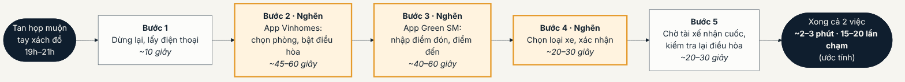
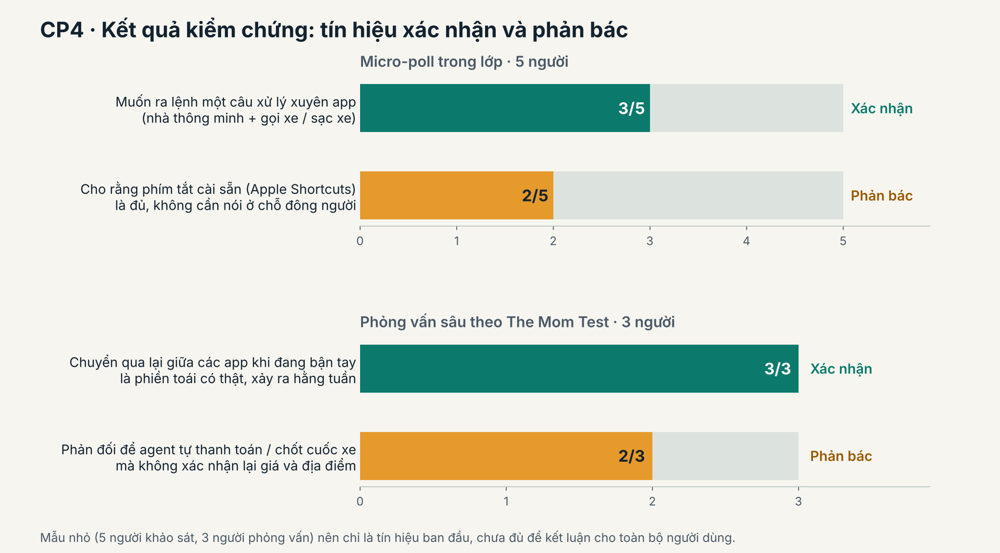
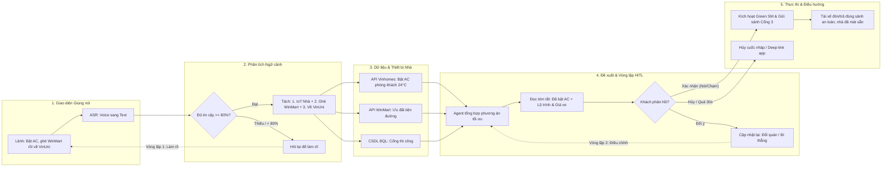
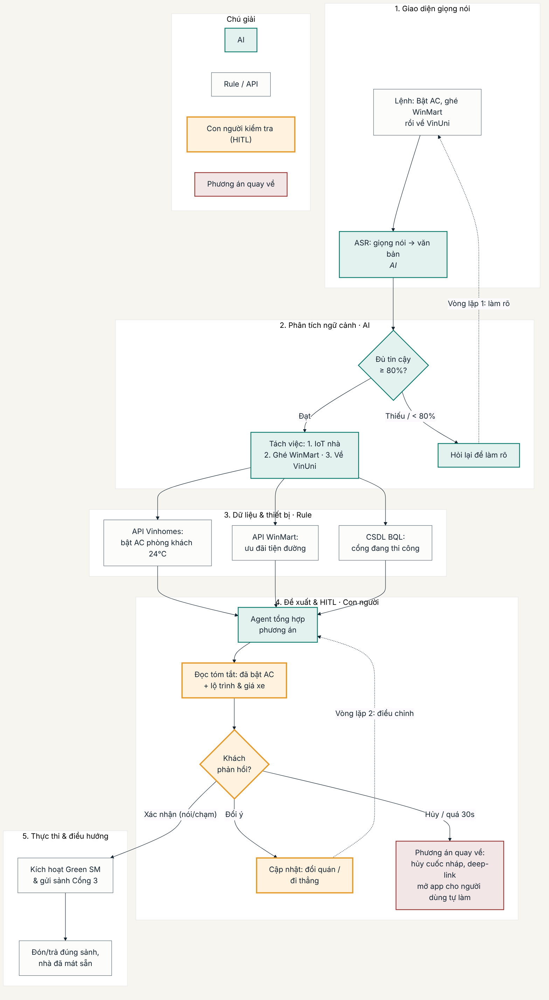

# Báo cáo nhóm — Day 02 Discovery & Problem Framing

> Bản chung của nhóm, viết trên repo do nhóm trưởng fork. Không copy file này sang repo cá nhân.
> Template chi tiết và prompt mẫu: [docs/01-worksheet.md](../../docs/01-worksheet.md). Bài mẫu: [docs/02-deliverable-example.md](../../docs/02-deliverable-example.md).

## 1. Thông tin nhóm

- Tên nhóm: HungTungTruyenHuy
- Thành viên: xem `TEAM.md`
- Candidate problem được chọn (1 câu): Nhân viên văn phòng là cư dân Vinhomes, khi tan họp và đang bận tay, muốn bật điều hòa ở nhà và đặt xe Green SM về nhà mà không phải dừng lại thao tác qua lại giữa hai ứng dụng.
- Quyết định cuối: Not Yet (xem mục 8.2)

---

## 2. Hội tụ nhóm (CP3)

### 2.1. Pitch

*Mỗi bài toán có một câu hỏi về điểm khác biệt hoặc lợi ích so với công cụ hiện có. Tên người hỏi là phân công đề xuất.*

| # | Người đưa ra | Candidate (Job Story ngắn) | Actor | Bottleneck | Câu hỏi phản biện nhận được (ai hỏi) |
| --- | --- | --- | --- | --- | --- |
| 1 | Đặng Nhật Huy | Khi tan họp và đang xách đồ, tôi muốn bật điều hòa ở nhà và đặt xe về nhà với ít thao tác, để chuẩn bị cả hai việc ngay khi rời văn phòng. | Nhân viên văn phòng sống tại Vinhomes, thường đi Green SM. | Chuyển giữa Vinhomes và Green SM để bật điều hòa, nhập điểm đón/đến và xác nhận xe. Ước tính 2–3 phút, hơn 15 lần chạm. | **Nguyễn Trọng Truyền:** So với [Siri Shortcuts](https://support.apple.com/en-mide/guide/shortcuts/apd07c25bb38/ios), agent của nhóm xử lý tốt hơn thế nào khi người dùng vừa yêu cầu bật điều hòa, vừa đổi giờ hoặc điểm đón xe trong cùng một câu? |
| 2 | Đặng Nhật Huy | Khi pin xe máy điện sắp hết giữa ca, tôi muốn biết tủ V-Green nào còn pin đầy lúc tôi đến, để tránh chạy vòng và lỡ cuốc. | Tài xế Green SM Bike, tài xế giao hàng và người dùng xe máy điện đổi pin V-Green. | Nếu tủ hết pin lúc đến, phải tìm và chạy sang tủ khác. Ước tính thêm 10–20 phút/lần. | **Đoàn Anh Hùng:** So với việc chọn tủ trên [bản đồ tủ đổi pin của VinFast E-Scooter](https://apps.apple.com/vn/app/vinfast-e-scooter/id1464483545), dự báo pin lúc đến giúp tài xế giảm được bao nhiêu chuyến đi hụt? |
| 3 | Đặng Nhật Huy | Khi xe điện báo lỗi hoặc có dấu hiệu lạ, tôi muốn biết mức độ nghiêm trọng và tìm gara nhận sửa xe điện gần đó, để quyết định bước xử lý tiếp theo. | Chủ ô tô hoặc xe máy điện đã hết bảo hành hoặc ở xa đại lý. | Tìm và đối chiếu ý kiến về lỗi, sau đó gọi hỏi các gara có nhận xe điện. Ước tính từ vài giờ đến một ngày. | **Nguyễn Thanh Tùng:** So với [VinFast AI](https://v-app.vn/mini/v-ai.v-app.vn), công cụ của nhóm giúp chủ xe ở xa đại lý tìm gara phù hợp nhanh hơn ở bước nào? |
| 4 | Nguyễn Thanh Tùng | Khi đọc tin tuyển dụng AI Fresher, tôi muốn đối chiếu yêu cầu với CV, để biết kỹ năng nào cần bổ sung. | Sinh viên mới tốt nghiệp đang tìm việc Fresher hoặc Junior. | Đối chiếu kỹ năng giữa JD và CV khi tin tuyển dụng dùng tiếng Việt, tiếng Anh và thuật ngữ khác nhau, mất 10–15 phút/lần. | **Nguyễn Trọng Truyền:** So với [Jobscan](https://www.jobscan.co/video-resume-match-report), công cụ của nhóm hiểu đúng hơn những yêu cầu nào trong tin tuyển dụng AI Fresher viết lẫn tiếng Việt và tiếng Anh? |
| 5 | Nguyễn Thanh Tùng | Khi phải đọc bài nghiên cứu tiếng Anh dài 15–20 trang trước buổi học, tôi muốn nắm ý chính và phương pháp, để kịp trao đổi trên lớp. | Học viên. | Đọc và chắt lọc nội dung học thuật, mất 40–50 phút ở hai bước đọc hiểu và ghi ý chính. | **Đoàn Anh Hùng:** Với cùng một paper, công cụ của nhóm giúp học viên hiểu đúng phương pháp và giới hạn của nghiên cứu hơn [NotebookLM](https://blog.google/innovation-and-ai/models-and-research/google-labs/notebooklm-student-features/) ở điểm nào? |
| 6 | Nguyễn Thanh Tùng | Khi sắp hết hạn nộp bài lab, tôi muốn kiểm tra tên file, cấu trúc thư mục và các mục báo cáo theo rubric, để tránh bị trừ điểm vì sai quy cách. | Học viên. | Soát từng file, thư mục và đầu mục báo cáo bằng tay, mất 10–15 phút và dễ bỏ sót sát hạn. | **Đặng Nhật Huy:** So với kiểm tra tự động bằng [GitHub Classroom](https://docs.github.com/en/education/manage-coursework-with-github-classroom/teach-with-github-classroom/use-autograding), công cụ của nhóm giúp học viên phát hiện thêm lỗi nào trước khi nộp bài? |
| 7 | Nguyễn Trọng Truyền | Khi khách gửi đơn qua email, tôi muốn nhập đúng mã hàng, số lượng và đơn vị tính vào ERP, để kho soạn đúng và kịp chuyến giao. | Nhân viên xử lý đơn và nhân viên kho. | Đọc từng dòng, dò tên viết tắt, mã và quy cách rồi nhập ERP. Ước tính 6 phút/đơn. | **Nguyễn Thanh Tùng:** So với [luồng nhập đơn của Dynamics 365](https://learn.microsoft.com/dynamics365/guidance/resources/import-sales-orders), cách của nhóm tiết kiệm được bao nhiêu thời gian cho đơn PDF nhiều mẫu khi tính cả công sửa sai mã hàng? |
| 8 | Nguyễn Trọng Truyền | Khi hóa đơn lệch so với đơn mua hoặc phiếu nhập, tôi muốn thấy dòng chênh lệch và chứng từ còn thiếu, để xác minh trước hạn thanh toán. | Kế toán công nợ, bộ phận mua hàng và kho. | Rà từng dòng để xác định lệch số lượng, đơn giá hoặc chứng từ. Ước tính 15 phút công/hóa đơn ngoại lệ, chưa tính thời gian chờ phản hồi. | **Đoàn Anh Hùng:** So với [đối chiếu ba chứng từ trong Dynamics 365](https://learn.microsoft.com/en-us/dynamics365/finance/accounts-payable/accounts-payable-invoice-matching), tính năng của nhóm giúp kế toán xử lý ca giao từng phần hoặc thiếu mã tham chiếu nhanh hơn ở bước nào? |
| 9 | Nguyễn Trọng Truyền | Khi tài xế gửi ảnh phiếu giao có chữ ký, tôi muốn biết phiếu thuộc lần giao nào và có giao thiếu hay không, để chốt trạng thái trong ngày. | Nhân viên điều phối và tài xế. | Mở ảnh, dò lần giao trong ERP và hỏi lại tài xế khi thiếu mã. Ước tính 5 phút công/ảnh. | **Đặng Nhật Huy:** So với [tính năng chụp ảnh giao hàng của Onfleet](https://support.onfleet.com/hc/en-us/articles/10348848090644-Proof-of-Delivery), cách của nhóm giảm được bao nhiêu công dò ảnh phiếu giấy khi ảnh thiếu mã chuyến? |
| 10 | Đoàn Anh Hùng | Khi cần ôn bài giảng dài 50–100 slide trong lúc di chuyển hoặc nghỉ, tôi muốn nắm các khái niệm cốt lõi, để ôn được trong thời gian ngắn. | Sinh viên và học viên các khóa kỹ thuật chuyên sâu. | Đọc, chắt lọc và ghi lại ý chính bằng tay, mất 45 phút/lần. | **Nguyễn Thanh Tùng:** So với [Audio Overview của NotebookLM](https://blog.google/innovation-and-ai/products/notebooklm/notebooklm-google-io-2026/), bản nghe của nhóm giúp học viên nhớ hoặc áp dụng công thức tốt hơn ở điểm nào sau cùng 10 phút ôn? |
| 11 | Đoàn Anh Hùng | Khi bắt đầu bài tập lớn với nhóm 3–4 người, tôi muốn chia yêu cầu thành các đầu việc có chuẩn bàn giao rõ, để cả nhóm làm song song mà không chồng chéo. | Trưởng nhóm hoặc thành viên điều phối dự án học tập. | Trao đổi để chia việc và thống nhất chuẩn bàn giao, mất 45 phút/lần. | **Nguyễn Trọng Truyền:** So với [gợi ý checklist của Trello](https://support.atlassian.com/trello/docs/adding-checklists-to-cards/), công cụ của nhóm giúp phát hiện sớm những việc nào đang phụ thuộc nhau để cả nhóm bớt phải chờ? |
| 12 | Đoàn Anh Hùng | Khi chạy mã nguồn hoặc notebook của bạn cùng nhóm, tôi muốn tái lập môi trường thực thi tương thích, để chạy được trên máy của mình. | Thành viên nhóm phụ trách chạy thử và tích hợp mã. | Dò và cài các phiên bản thư viện hoặc driver tương thích, mất 45 phút/lần. | **Đặng Nhật Huy:** So với [VS Code Dev Containers](https://code.visualstudio.com/docs/devcontainers/containers), công cụ của nhóm giúp đưa mã chạy được sớm hơn trong trường hợp nào, chẳng hạn khi hai máy dùng driver GPU khác nhau? |

### 2.2. Cluster

| Cluster | Các candidate | Pattern chung |
|---|---|---|
| A — Thao tác rời rạc giữa các ứng dụng | #1 Bật điều hòa và đặt xe về nhà | Một nhu cầu gồm hai việc nhưng người dùng phải mở từng ứng dụng, nhập thông tin và kiểm tra kết quả riêng. Bất tiện rõ hơn khi đang di chuyển hoặc bận tay. |
| B — Thiếu thông tin để quyết định khi đang di chuyển | #2 Tìm tủ còn pin khi tới nơi, #3 Hiểu cảnh báo xe điện và tìm gara | Người dùng cần biết bước tiếp theo trong thời gian ngắn. Thông tin có thể thay đổi trước khi tới nơi hoặc phải xác nhận qua nhiều nguồn. |
| C — Đọc và chắt lọc tài liệu dài | #5 Đọc paper tiếng Anh, #10 Ôn bài giảng dài | Học viên có ít thời gian nhưng phải đọc nhiều để tìm ý chính, giữ đúng phương pháp, công thức hoặc sơ đồ quan trọng. |
| D — Đối chiếu dữ liệu giữa các nguồn | #4 Đối chiếu CV với JD, #7 Nhập đơn ERP, #8 Rà hóa đơn lệch, #9 Ghép phiếu giao hàng | Thông tin liên quan nằm ở các tài liệu hoặc hệ thống khác nhau. Người xử lý phải dò mục tương ứng, tìm phần thiếu và xác minh chỗ không khớp. |
| E — Kiểm tra điều kiện trước khi nộp hoặc chạy | #6 Soát quy cách nộp bài lab, #12 Tái lập môi trường chạy mã | Tên tệp, cấu trúc thư mục hoặc phiên bản phụ thuộc phải đáp ứng yêu cầu. Dò từng điều kiện bằng tay mất thời gian và dễ sót lỗi. |
| F — Điều phối công việc nhóm | #11 Chia việc và thống nhất bàn giao | Nhóm phải làm rõ ai phụ trách, việc nào phụ thuộc nhau và thế nào là bàn giao đủ để các thành viên làm song song. |

### 2.3. Opportunity Solution Tree rút gọn

Cây tập trung vào ba candidate #1–#3 vì cùng liên quan đến việc chuẩn bị hoặc xử lý phát sinh trong hành trình di chuyển.

```text
OUTCOME: Giảm số phút người dùng mất để hoàn tất việc chuẩn bị hoặc xử lý phát sinh trong hành trình.
├── A · #1: Người dùng bận tay vẫn cần chuẩn bị cả việc ở nhà và xe về nhà.
│   ├── Phải chuyển qua lại giữa hai ứng dụng để hoàn thành hai việc.
│   └── Phải kiểm tra riêng xem điều hòa đã bật và xe đã được đặt chưa.
├── B · #2: Tài xế cần biết tủ có còn pin đầy lúc mình tới, nhất là khi pin xe sắp hết.
└── B · #3: Khi xe báo lỗi, chủ xe cần biết tình trạng có cần hỗ trợ ngay không
    và nơi nào gần đó thực sự nhận sửa loại xe của mình.
```

Với **#1**, đo từ lúc người dùng bắt đầu thao tác đến khi có trạng thái xác nhận cho cả hai việc. Đo thêm tỷ lệ hoàn thành đúng cả hai tác vụ để tránh kết luận tốt chỉ vì thao tác nhanh hơn. Ghi riêng thời gian chờ tài xế nhận cuốc.

**Các ý để ở tầng giải pháp**

- Agent giọng nói đa bước hoặc nút «Về nhà» cài sẵn cho #1.
- Dự báo tồn pin hoặc giữ pin trước cho #2.
- Trợ lý đọc cảnh báo và danh bạ gara cho #3.

### 2.4. Chấm điểm shortlist (1–5)

Shortlist so ba bài toán của ba thành viên, thuộc ba nhóm khác nhau trong mục 2.2. Điểm là đề xuất dựa trên Problem Card. #6 có ghi nhận một lần bị trừ điểm do sai tên tệp nên được 3/5 về bằng chứng. #1 và #7 chủ yếu dựa trên kịch bản và thời gian ước tính nên được 2/5.

| Candidate | Người đề xuất | Actor rõ | Quy trình rõ | Pain có bằng chứng | Impact đo được | Vừa sức lab | So sánh được No AI/Rule/Workflow/Agent | Nhóm hiểu domain | Tổng |
| --- | --- | --- | --- | --- | --- | --- | --- | --- | --- |
| #1 — Bật điều hòa và đặt xe khi đang bận tay | Đặng Nhật Huy | 5 | 5 | 2 | 5 | 4 | 5 | 3 | 29 |
| #6 — Kiểm tra quy cách nộp bài lab | Nguyễn Thanh Tùng | 5 | 5 | 3 | 5 | 5 | 3 | 5 | 31 |
| #7 — Nhập đơn đặt hàng vào ERP | Nguyễn Trọng Truyền | 5 | 5 | 2 | 5 | 3 | 4 | 3 | 27 |

**Candidate được chọn — #1 của Đặng Nhật Huy.** Khi tan họp muộn và đang xách đồ, tôi muốn bật điều hòa ở nhà và đặt xe Green SM với ít thao tác, để chuẩn bị cả hai việc ngay khi rời văn phòng.
 
Quy trình hiện tại của candidate #1 (Problem Card, CP2):



**Vì sao chọn.** #6 có tổng điểm cao hơn nhờ dễ thử trong lab và có ghi nhận về lỗi đã xảy ra. Nhóm ưu tiên #1 để đào sâu trải nghiệm khi người dùng phải làm hai việc trên hai ứng dụng trong hệ sinh thái Vin. Có thể mô phỏng hai dịch vụ và so thao tác hiện tại, nút «Về nhà» cài sẵn, luồng giọng nói có bước cố định và agent hiểu câu nói tự do. Dùng cùng tình huống để đo thời gian, số lần chạm và tỷ lệ hoàn thành đúng cả hai việc. Ca đổi giờ hoặc điểm đón giúp kiểm tra agent có mang lại lợi ích thêm hay không. Khả năng tích hợp thật cần được kiểm chứng riêng.

**Vì sao chưa chọn hai candidate còn lại**

- **#6 — Kiểm tra quy cách nộp bài lab.** Dễ thử ngay với tệp và thư mục mẫu. Các lỗi chính như sai tên tệp, thiếu thư mục hoặc thiếu đề mục có thể bắt bằng script, nên phạm vi để thử thêm AI tương đối hẹp.
- **#7 — Nhập đơn vào ERP.** Có chỉ số rõ về thời gian nhập và lỗi mã hàng, số lượng, đơn vị tính. Số giờ trong card là ước tính và cần đơn thực tế cùng danh mục hàng để biết mẫu chuẩn và bảng mã xử lý được bao nhiêu trường hợp. Nếu chỉ dùng dữ liệu giả lập, khó kết luận về tác động vận hành.

**Xử lý bất đồng.** Chưa có ghi nhận về bất đồng. Lý do ưu tiên #1 dù #6 có tổng điểm cao hơn được ghi ở mục «Vì sao chọn».

---

## 3. Kiểm chứng + research giải pháp đã có (CP4)

### 3.1. Assumption Map

| # | Giả định | Loại (Value / Usability / Feasibility / Viability) | Quan trọng (1–5) | Đã có bằng chứng (1–5) | Kiểm chứng trước? |
|---:|---|---|---:|---:|:---:|
| 1 | Người dùng có nhu cầu thực tế muốn ra lệnh giọng nói tự nhiên cho nhiều tác vụ gộp cùng lúc (vừa bật điều hòa nhà vừa gọi xe đón về) thay vì tự mở từng app. | **Value** | 5 | 2 | ✅ |
| 2 | Người dùng chấp nhận để Agent tự động đặt xe Green SM và thanh toán nếu có một câu hỏi xác nhận nhanh bằng giọng nói (không cần chạm tay). | **Usability** | 5 | 1 | ✅ |
| 3 | Khó khăn lớn nhất của người dùng là thao tác chạm màn hình điện thoại khi tay đang bận (lái xe, xách đồ, đi bộ vội) chứ không phải tốc độ mạng hay thời gian app khởi động. | **Value** | 4 | 3 | — |
| 4 | LLM kết hợp Function Calling / Tool Calling có thể hiểu câu lệnh tiếng Việt tự nhiên đa vùng miền và phân rã chính xác thành các tham số API riêng biệt cho từng app. | **Feasibility** | 4 | 3 | — |
| 5 | Các hệ thống app đối tác (VinFast, Green SM, Vinhomes) cho phép chia sẻ phiên đăng nhập / token xác thực an toàn để Agent thực thi mà không vi phạm chính sách bảo mật người dùng. | **Viability** | 4 | 2 | — |

Giả định nhóm kiểm chứng trong buổi này: **Giả định #1 và #2** (Xác định nhu cầu ra lệnh gộp xuyên app có thật không, và mức độ tin tưởng của người dùng khi giao quyền đặt xe/tiền cho AI).

### 3.2. Kiểm chứng

Cách đã dùng: Phỏng vấn nhanh (3 người thật theo nguyên tắc The Mom Test) + Micro-poll nhanh trong lớp (5 người).


#### Interview Snapshot #1

Bản đầy đủ kèm tín hiệu rút ra: [cp4-interview-snapshot-1.md](../assets/cp4-interview-snapshot-1.md)

| Trường | Nội dung |
|---|---|
| Người được hỏi (vai trò, không ghi tên thật) | Nhân viên văn phòng (27 tuổi), hiện là cư dân Vinhomes Ocean Park, thường xuyên đi làm bằng Green SM |
| Câu nói đáng nhớ nhất (nguyên văn) | *"Nhiều hôm tan làm, vừa đi ra cửa vừa phải đứng nép vào góc bấm app Vin mở điều hòa trước cho mát, xong lại chuyển sang app Xanh SM gõ địa chỉ đặt xe, phiền dã man. Nếu chỉ cần nói một câu mà nó làm hết thì quá tiện."* |
| Lần gần nhất gặp vấn đề này: chuyện gì đã xảy ra? | Tối thứ Sáu tuần trước (khoảng 19h30), vừa tan họp, tay cầm tài liệu và túi xách, đứng ở sảnh công ty mất gần 2 phút để thao tác qua lại giữa 2 app. |
| Hiện đang xử lý bằng cách nào (workaround)? | Đặt xe Xanh SM trước khi xuống thang máy, khi xe đến mới vội vàng mở app Vinhomes bật điều hòa; thỉnh thoảng về đến nhà mới nhớ ra là quên bật điều hòa. |
| Mất bao lâu, bao lần? | 2–3 phút cho mỗi lần thao tác, lặp lại 3–4 ngày trong tuần. |
| Insight / opportunity rút ra | Thao tác đa app khi đang di chuyển tạo ra sự đứt gãy trải nghiệm rất lớn; người dùng có nhu cầu kết hợp "điều hòa nhà mát sẵn" với "giờ xe đón về". |

#### Interview Snapshot #2

| Trường | Nội dung |
|---|---|
| Người được hỏi (vai trò, không ghi tên thật) | Kỹ sư phần mềm (30 tuổi), đang sở hữu xe điện VinFast VF8 và sử dụng nhà thông minh |
| Câu nói đáng nhớ nhất (nguyên văn) | *"Bảo nó bật điều hòa phòng khách thì thoải mái, nhưng bảo nó tự ấn đặt xe trừ tiền trong thẻ thì mình hơi ghê tay. Nhỡ nó nghe nhầm địa chỉ hoặc đặt loại xe đắt tiền thì phải huỷ chuyến phiền lắm."* |
| Lần gần nhất gặp vấn đề này: chuyện gì đã xảy ra? | Tuần trước dùng trợ lý ảo ViVi trên xe ra lệnh chỉnh điều hòa và phát nhạc, nhưng khi muốn điều khiển thiết bị nhà thông minh từ trên xe thì ViVi báo chưa hỗ trợ. |
| Hiện đang xử lý bằng cách nào (workaround)? | Đỗ xe lại hoặc chờ đèn đỏ để rút điện thoại ra bấm app SmartHome. |
| Mất bao lâu, bao lần? | Mất khoảng 1–2 phút, ngày nào cũng lặp lại khi đi làm về. |
| Insight / opportunity rút ra | Người dùng phân biệt rất rõ giữa tác vụ rủi ro thấp (bật thiết bị) và tác vụ liên quan đến tiền/vị trí (đặt xe). Với tiền bạc, họ bắt buộc cần bước xác nhận rõ ràng. |

Tổng hợp:

| Nguồn | Số người / số mẫu | Tín hiệu xác nhận | Tín hiệu phản bác |
|---|---:|---|---|
| Phỏng vấn sâu (The Mom Test) | 3 người | 3/3 người đều xác nhận việc chuyển đổi qua lại giữa các app dịch vụ khi đang bận tay là nỗi phiền toái có thật và xảy ra hàng tuần. | 2/3 người kịch liệt phản đối việc để Agent tự động thanh toán tiền / chốt cuốc xe mà không có bước xác nhận lại chi phí và địa điểm. |
| Micro-poll trong lớp | 5 người | 3/5 người muốn có khả năng ra lệnh một câu xử lý xuyên app (nhà thông minh + gọi xe / sạc xe). | 2/5 người cho rằng dùng phím tắt cài sẵn (như Apple Shortcuts) bấm 1 nút trên màn hình khóa là đủ nhanh, không nhất thiết phải nói bằng giọng nói ở chỗ đông người. |



**Nhóm đã sửa problem thế nào sau kiểm chứng:**
1. **Thiết lập ranh giới an toàn (Boundary & Human-in-the-Loop)**: Không để Agent tự động thực hiện hoàn toàn từ đầu đến cuối đối với các tác vụ liên quan đến tài chính/đặt xe. Agent chỉ chuẩn bị sẵn thông tin cuốc xe (loại xe, giá tiền, điểm đón) và đọc lại xác nhận: *"Giá cước 85.000đ về Vinhomes, bạn có xác nhận đặt không?"*, người dùng nói "Đồng ý" thì mới gọi API đặt. Còn việc bật điều hòa thì tự động thực hiện ngay.
2. **Bổ sung kênh tương tác kép**: Bên cạnh giọng nói, hỗ trợ hiển thị thẻ tóm tắt (Action Card) trên màn hình khóa điện thoại để người dùng có thể nhìn nhanh hoặc bấm chạm khi ở nơi công cộng ồn ào.

### 3.3. Research giải pháp đã có

| Công cụ / case / pattern | Link | Giải bước nào trong quy trình? | Điểm mạnh | Khoảng trống / rủi ro | Bài học cho nhóm |
|---|---|---|---|---|---|
| **Apple Shortcuts (Siri App Intents)** | https://support.apple.com/guide/shortcuts/welcome/ios | Hỗ trợ xâu chuỗi nhiều hành động xuyên app (Routine) qua lệnh Siri | Chạy mượt trên hệ điều hành, bảo mật cao, không tốn chi phí server LLM | Cực kỳ cứng nhắc: người dùng phải tự cấu hình thủ công từng bước; không hiểu được biến thể ngôn ngữ tự nhiên (vd: nói "nóng quá bật trước máy lạnh" là chịu) | Nhóm không nên cạnh tranh về mặt framework hệ điều hành, mà tập trung vào **khả năng hiểu ngữ nghĩa tự nhiên và tự động suy luận tham số** của LLM. |
| **Trợ lý ảo VinFast ViVi (VinAI / Cerence)** | https://vinfastauto.com/vn_vi/tro-ly-ao-vinfast | Nhận diện giọng nói tiếng Việt đa vùng miền, điều khiển tính năng trên xe | Nhận diện giọng nói tiếng Việt cực tốt, độ trễ thấp, đã tích hợp sâu trên phần cứng xe VinFast | Chỉ hoạt động cục bộ trên xe, chưa mở rộng ra hệ sinh thái di động ngoài xe (chưa điều khiển chéo sang app Vinhomes hay Green SM trên điện thoại) | Tận dụng năng lực ASR (Speech-to-Text) tiếng Việt đã trưởng thành, Agent đóng vai trò là **bộ não điều phối (Orchestrator)** kết nối các API dịch vụ lại với nhau. |
| **Rabbit R1 / Large Action Model (LAM)** | https://www.rabbit.tech/research | Tự động hóa thao tác trên giao diện app thay người dùng qua giọng nói | Ý tưởng tương tác xuyên app rất đột phá, không phụ thuộc hoàn toàn vào API chính thức | Gặp lỗi nghiêm trọng về độ trễ (mất 5–10s), dễ gãy khi giao diện app thay đổi, rủi ro bảo mật tài khoản cực cao | **Không nên đi theo hướng tự click màn hình (Computer Use / LAM)** vì thiếu ổn định; giải pháp đúng đắn là xây dựng **Function Calling chuẩn hóa qua API chính thức** với các bước kiểm tra an toàn. |

## 4. Quy trình trước/sau (CP5)

### 4.1. Quy trình hiện tại

Sơ đồ (ASCII, Mermaid hoặc link ảnh trong `report/assets/`):

```text
HIỆN TẠI — 18–28 phút cho lộ trình đa điểm, bật thiết bị nhà & định vị nội khu

[Tan làm, muốn bật điều hòa, ghé WinMart & về Tòa B VinUni: 0']
→ [Mở app Vinhomes Resident, chọn phòng khách, bật điều hòa 24°C: 45s]
→ [Mở Facebook group cư dân / Web tìm xem tối nay có sự kiện, quán ăn nào hot: 5–7']
→ [Mở app VinID/WinMart dò xem chi nhánh nào gần lộ trình có khuyến mãi: 3–5']
→ [Mở app Green SM, đặt chặng 1 đến WinMart: 2']
→ [Đến WinMart mua đồ, xong lại mở app Green SM đặt chặng 2 về VinUni: 2–3']
→ [Tài xế chạy đến Cổng 1 VinUni bị rào chắn thi công, phải gọi điện chỉ đường lòng vòng: 5–10'] ← BOTTLENECK CỰC LỚN
```

| Bước | Actor | Input | Output | Thời gian / tần suất | Ghi chú |
|---:|---|---|---|---|---|
| 1 | Người dùng | App Vinhomes Resident | Điều hòa phòng khách được bật 24°C | 45 giây / 1 lần | Phải mở app nhà thông minh thao tác riêng trước khi ra về |
| 2 | Người dùng | Nhu cầu ăn uống, mua sắm cuối tuần | Danh sách địa điểm/quán ăn dự kiến | 5–7 phút / Cuối tuần | Phải lướt thủ công các nhóm cư dân, Fanpage Vincom để tìm sự kiện/quán ngon |
| 3 | Người dùng | App VinID / WinMart | Chọn được chi nhánh WinMart có voucher/ưu đãi | 3–5 phút / 1 lần | Tra cứu danh mục khuyến mãi trên app riêng lẻ |
| 4 | Người dùng | App Green SM | Đặt cuốc xe chặng 1 (Văn phòng $\to$ WinMart) | 2 phút / 1 lần | Nhập địa chỉ, chờ xe đến đón |
| 5 | Người dùng | Mua sắm xong tại WinMart | Đặt tiếp cuốc xe chặng 2 (WinMart $\to$ VinUni) | 2–3 phút / 1 lần | Thao tác lại quy trình gọi xe lần thứ hai |
| 6 | Người dùng & Tài xế | Xe đến khuôn viên VinUni / Vinhomes | Xe tìm được sảnh đến thực tế | 5–10 phút / 1 lần | **Bottleneck chính:** Bản đồ app không cập nhật công trường thi công; tài xế bị kẹt ở cổng đóng, phải gọi điện qua lại nhiều lần để chỉ đường nội khu |

**Bottleneck chính:** 
1. *Bước 1, 2 & 3:* Phải tự xâu chuỗi và chuyển đổi qua lại giữa 3 ứng dụng độc lập (Vinhomes điều khiển nhà, VinID tìm voucher, Facebook cư dân).
2. *Bước 6:* "Mù thông tin nội khu" — tài xế và khách mất 5–10 phút gọi điện cãi nhau vì cổng vào bị rào chắn công trình, phải đi bộ xa hoặc quay đầu xe lòng vòng.

### 4.2. Quy trình tương lai

Ghi rõ bước nào **Rule**, bước nào **AI**, bước nào **con người**, **boundary** ở đâu, **phương án quay về** khi AI sai.



Bản ảnh (dùng khi sơ đồ Mermaid không hiển thị): 

**Phân định các tầng can thiệp & An toàn:**
- **Tầng AI (LLM & Context Reasoner):**
  - Hiểu câu lệnh tự nhiên phức tạp chứa đa tác vụ: *"Bật điều hòa trước"*, *"Ghé WinMart tiện đường có giảm giá"*, *"Tránh cổng đang sửa chữa"*.
  - Ghép nối thông tin ưu đãi từ WinMart với lộ trình di chuyển tối ưu nhất của Green SM.
- **Tầng Rule / Dữ liệu thời gian thực (Real-time Context Engine):**
  - **Tích hợp Smart Home:** Gửi lệnh qua API Vinhomes Smart Home để kích hoạt điều hòa phòng khách 24°C (chạy ngầm tức thì, không làm nghẽn luồng gọi xe).
  - **Bản đồ nội khu (Internal POI & Status):** Cổng 1 (Đang thi công rào chắn) $\to$ Tự động gán điểm đón/trả khả dụng gần nhất cho Tòa B là Cổng 3.
  - Tự động điền lộ trình 2 chặng vào API của Green SM (không bắt người dùng tự gõ 2 lần).
- **Tầng Con người kiểm soát (HITL):**
  - **Cổng chốt tiền tệ (Financial Gate):** Agent **không bao giờ được tự động bấm thanh toán/đặt xe**. Agent phải đọc lại tóm tắt (đã bật AC, chi nhánh WinMart được chọn, loại xe và tổng giá tiền) và chờ người dùng nói *"Xác nhận"* hoặc bấm 1 chạm.
- **Ranh giới an toàn (Boundary):**
  - AI chỉ được phép điều khiển các thiết bị gia dụng cơ bản (điều hòa, bình nóng lạnh, rèm cửa); **tuyệt đối không được can thiệp vào khóa cửa thông minh (Smart Lock), camera an ninh hoặc ngắt cầu dao điện tổng**.
  - AI **không được** tự ý đặt vào các quán ăn/địa điểm có đánh giá dưới 4 sao hoặc không có thông tin rõ ràng.
  - AI **không được** tự chốt lộ trình phát sinh thêm cước phí dịch vụ phụ nếu chưa báo trước.
- **Phương án quay về (Fallback):**
  - *Nếu dữ liệu thi công cổng không chắc chắn:* Agent thông báo: *"Chưa có dữ liệu cập nhật về cổng thi công hôm nay, tôi sẽ đặt xe đến Cổng chính và đính kèm số bảo vệ trường để tài xế gọi nếu cần."*
  - *Nếu mất kết nối IoT nhà thông minh:* Agent vẫn tiếp tục tiến trình đặt xe và báo rõ: *"Không kết nối được điều hòa phòng khách, vui lòng kiểm tra lại app Vinhomes sau."*
  - *Nếu giọng nói bị nhiễu không dịch được:* Báo lỗi giọng nói và kích hoạt Deep-link mở sẵn app Green SM / VinID / Vinhomes.

### 4.3. Before / after

| Chỉ số | Trước | Sau (kỳ vọng) | Ghi chú |
|---|---:|---:|---|
| Số bước | 6 ứng dụng / thao tác rời rạc (Vinhomes, Facebook, VinID, Green SM x2, Gọi điện) | 1 tương tác giọng nói + 1 chạm xác nhận | Gom toàn bộ quy trình điều khiển nhà, tra cứu ưu đãi và đặt xe |
| Tổng thời gian | 18–28 phút | $\le 30$ giây | Giảm hơn 95% thời gian thao tác và tìm kiếm |
| Số bước thủ công | 25+ lần chạm và thao tác tìm kiếm | 0 lần chạm (hoặc 1 chạm xác nhận) | Rảnh tay hoàn toàn khi di chuyển |
| Trạng thái khi về đến nhà | Phải nhớ mở app bật AC trước 30p | Nhà luôn mát sẵn 24°C tự động | Nâng cao chất lượng sống và tiện nghi |
| Bottleneck chính | Mù thông tin khuyến mãi & lạc đường nội khu | Độ trễ API & tính chính xác dữ liệu cổng của BQL | Chuyển việc mò đường thủ công sang dữ liệu đồng bộ của BQL |
| Rủi ro mới phát sinh | Mất nhiều thời gian tự tìm | Dữ liệu thi công của BQL bị trễ; gợi ý khuyến mãi không đúng sở thích | Bổ sung cơ chế cho phép người dùng từ chối chặng dừng ghé mua sắm |

---

## 5. Problem Statement v0 (CP5)

| Trường | Nội dung |
|---|---|
| **Actor** | Cư dân Vinhomes sở hữu căn hộ thông minh, cán bộ/sinh viên VinUni di chuyển bằng Green SM và sinh hoạt trong hệ sinh thái Vingroup. |
| **Quy trình** | Khi chuẩn bị về nhà kết hợp mua sắm/tiện ích nội khu (bật điều hòa đón trước, ghé WinMart có ưu đãi, đến tòa nhà cụ thể trong khuôn viên lớn), người dùng phải tự mở app Vinhomes điều khiển nhà, tự tìm kiếm khuyến mãi trên nhiều kênh, tự đặt nhiều cuốc xe lẻ và phải liên tục gọi điện thoại chỉ đường cho tài xế để né các khu vực rào chắn/thi công. |
| **Bottleneck** | 1. Thiếu sự liên kết dữ liệu giữa dịch vụ điều khiển nhà (Vinhomes Smart Home), di chuyển (Green SM) với tiện ích mua sắm (WinMart).<br>2. Ứng dụng bản đồ hiện tại không có dữ liệu vi mô (micro-routing) về tình trạng đóng/mở cổng và công trường thi công nội khu, dẫn đến tài xế thả sai sảnh hoặc lạc đường. |
| **Impact** | Lãng phí 18–28 phút mỗi chuyến đi; phát sinh mâu thuẫn giữa khách và tài xế; người dùng về đến nhà bị nóng bức do quên bật điều hòa hoặc bỏ lỡ các ưu đãi mua sắm ngay trên đường đi; giảm trải nghiệm sống thông minh tại khu đô thị. |
| **Success Metric** (baseline → target, cách đo) | • **Baseline:** Mất trung bình 20 phút cho việc tra cứu khuyến mãi, bật thiết bị và chỉ đường nội khu; 40% cuốc xe vào khuôn viên lớn gặp sự cố dừng sai sảnh.<br>• **Target:** Rút ngắn thời gian lên lộ trình, bật thiết bị và gọi xe xuống dưới 30 giây; giảm tỷ lệ tài xế gọi điện hỏi đường/sai cổng xuống dưới 5%; tỷ lệ kích hoạt thành công điều hòa đạt $\ge 95\%$.<br>• **Cách đo:** Thử nghiệm 10 cuốc xe thực tế vào các khu vực đang thi công nội khu VinUni / Vinhomes Ocean Park để đo thời gian, tỷ lệ lệnh IoT thành công và số cuộc gọi phát sinh. |
| **Boundary** (AI không được làm gì; khi nào cần con người kiểm tra — HITL) | • AI **không được** tự chốt lộ trình phát sinh cước phí nếu không có sự xác nhận của người dùng (HITL).<br>• AI **tuyệt đối không can thiệp** vào khóa cửa thông minh (Smart Lock), camera giám sát hoặc hệ thống điện an ninh.<br>• AI **chỉ định tuyến** vào các cổng đã được Ban Quản Lý (BQL) xác nhận an toàn cho xe cơ giới.<br>• Khi phát hiện dữ liệu công trường chưa rõ ràng, AI bắt buộc phải cảnh báo người dùng và gợi ý điểm đón an toàn nhất ở cổng ngoài. |

Phản biện nhận được (từ AI hoặc nhóm khác) và nhóm có đồng ý không:

- **Phản biện 1:** *"Liệu Ban quản lý khu đô thị/trường học có cung cấp API dữ liệu cổng thi công thời gian thực cho Agent không?"* $\to$ **Đồng ý:** Đây là rào cản Feasibility. Nhóm đã bổ sung cơ chế Fallback: nếu chưa có API tự động, hệ thống sử dụng kênh cập nhật bán thủ công từ thông báo hàng ngày của BQL hoặc cho phép tài xế/cư dân báo lỗi cộng đồng (crowdsourced).
- **Phản biện 2:** *"Nếu gợi ý WinMart ghé mua sắm làm phát sinh thêm thời gian chờ của tài xế và tăng cước phí thì sao?"* $\to$ **Đồng ý:** Nhóm đã thiết kế hiển thị/đọc rõ tổng giá tiền và phụ phí chờ trước khi người dùng bấm xác nhận chặng dừng.
- **Phản biện 3:** *"Lỡ AI hiểu nhầm lệnh giọng nói rồi tự ý bật/tắt các thiết bị nhạy cảm như bình nước nóng hoặc mở khóa nhà thì sao?"* $\to$ **Đồng ý:** Nhóm đã đặt Boundary cứng: Chỉ cho phép điều khiển điều hòa và đèn chiếu sáng; loại trừ hoàn toàn quyền truy cập của AI đối với Smart Lock và cầu dao điện tổng.

---


## 6. Mức can thiệp AI (CP6)

### 6.1. Ma trận độ mơ hồ × độ phức tạp

Bài của nhóm nằm ở ô: **Độ mơ hồ cao × Độ phức tạp cao**

Vì sao:
- **Mơ hồ cao:** người dùng nói tự nhiên, mỗi người một kiểu ("bật điều hòa", "mở máy lạnh", "cho nhà mát trước đi"), có giọng Bắc, Trung, Nam và tiếng ồn. Một câu có thể thiếu thông tin ("chuyển tiền cho Lan" khi danh bạ có 2 người tên Lan) hoặc nằm ngoài khả năng của các app đã cài.
- **Phức tạp cao:** một câu nói có thể cần nhiều bước trên nhiều app (Vinhomes + Green SM). Thứ tự và tham số mỗi lần mỗi khác, và phải kiểm tra trạng thái app sau khi làm.

Tuy vậy, **không phải mọi yêu cầu đều ở ô này.** Các lệnh đơn như "tắt hết đèn tầng một" có độ mơ hồ và độ phức tạp thấp, nên Rule hoặc Workflow đã xử lý được.

### 6.2. So sánh 4 mức

| Mức | Phương án cho bài của nhóm | Đủ khi nào | Rủi ro | Chọn? |
|---|---|---|---|---|
| **No AI** (sửa quy trình) | Gộp bật điều hòa và gọi xe vào chung một màn hình trong app; hẹn giờ điều hòa theo lịch cố định | Người dùng về nhà giờ cố định, chỉ làm 1–2 việc quen thuộc | Vẫn phải dừng lại và dùng tay; không giúp được người cao tuổi; không xử lý được ngày về muộn bất thường | ❌ |
| **Rule** | Nút hoặc câu lệnh "Về nhà" cài sẵn: bật điều hòa 26°C và gọi xe 4 chỗ từ công ty về nhà | Yêu cầu lặp lại giống hệt nhau mỗi lần | Không xử lý được khi thay đổi (điểm đến khác, phòng khác, thêm việc khác); người dùng phải tự cài và nhớ | ⚠️ Dùng cho kịch bản quen thuộc |
| **Workflow** | Lệnh giọng nói theo mẫu cố định; AI chỉ nhận dạng câu và điền tham số vào luồng có sẵn (ví dụ: "Bật [thiết bị] ở [phòng]") | Mỗi câu chỉ có 1 ý, nói đúng mẫu | Câu nhiều ý hoặc nói khác mẫu thì thất bại; không biết hỏi lại khi thiếu thông tin | ⚠️ Dùng cho bước thực thi |
| **Agent** | AI tự hiểu câu nói tự nhiên, tách thành nhiều việc, chọn app và tham số, tự quyết hỏi lại hay từ chối | Yêu cầu đa dạng, nhiều bước, nhiều app, có thể thiếu thông tin | Làm nhầm (đặt sai xe, chuyển nhầm tiền); khó dự đoán; chi phí gọi LLM cao; khó kiểm thử | ✅ Có giới hạn |

**Mức chọn:** **Agent có giới hạn, kết hợp Workflow và Rule**
- **Agent** chỉ làm phần *hiểu yêu cầu và lập kế hoạch*: tách câu thành các việc, quyết định làm, hỏi lại hay từ chối.
- **Workflow** làm phần *thực thi*: mỗi việc đi qua một luồng gọi app đã định sẵn, có kiểm tra tham số.
- **Rule** xử lý các phần cố định: địa chỉ quen ("nhà", "công ty"), giá trị mặc định (nhiệt độ 26°C), và **bắt buộc xác nhận** mọi hành động có tiền.

**Vì sao không chọn mức đơn giản hơn:**
- **Rule** chỉ đúng khi yêu cầu lặp lại giống hệt. Trong khi đó, giá trị của bài toán nằm ở những lần yêu cầu thay đổi: về muộn, đi nơi khác, thêm việc khác, hoặc người cao tuổi không tự cài được.
- **Workflow** cần người dùng nói đúng mẫu và mỗi câu một ý. Nhưng người dùng nói tự nhiên, nhiều ý trong một câu, và thiếu thông tin là chuyện thường gặp. Workflow không tự quyết được khi nào cần hỏi lại.
- **Điều kiện để hạ mức:** nếu kiểm chứng ở CP4 cho thấy phần lớn yêu cầu lặp lại giống nhau (ví dụ trên 70% là cùng một kịch bản "về nhà"), nhóm sẽ hạ xuống Rule + Workflow.

### 6.3. AI Canvas rút gọn

| Thành phần | Nội dung |
|---|---|
| **Prediction** — AI dự đoán / tạo ra gì? | Văn bản từ giọng nói (ASR); ý định của người dùng; danh sách việc cần làm kèm tham số (phòng, nhiệt độ, điểm đón, điểm đến, loại xe, người nhận, số tiền); quyết định **làm / hỏi lại / từ chối** |
| **Judgment** — con người cân nhắc, quyết định gì? | Xác nhận các hành động có tiền (đặt xe, chuyển khoản); chọn khi có nhiều phương án (Lan nào, xe 4 hay 7 chỗ); hủy khi agent hiểu sai |
| **Action** — hành động cuối cùng là gì, ai làm? | Hệ thống gọi API của app (Vinhomes bật điều hòa, Green SM đặt xe, nhắc lịch) sau khi qua kiểm tra của Rule; người dùng xác nhận với hành động có tiền; hệ thống đọc lại kết quả bằng giọng nói |
| **Outcome** — đo kết quả bằng gì? | Tỷ lệ app ở đúng trạng thái người dùng yêu cầu; thời gian từ lúc nói đến khi xong việc (baseline khoảng 2–3 phút); tỷ lệ hỏi lại đúng lúc; tỷ lệ từ chối đúng; tỷ lệ người dùng phải hủy hoặc tự làm lại |
| **Input** — AI cần dữ liệu đầu vào gì mỗi lần chạy? Có sẵn không? | Âm thanh yêu cầu (có sẵn); ngữ cảnh người dùng: vị trí, địa chỉ đã lưu, danh bạ, thiết bị trong nhà (có sẵn trong app, cần người dùng cho phép); danh sách app đã cài và chức năng của chúng (**chưa có API công khai**, bản thử dùng môi trường giả lập) |
| **Feedback** — lấy phản hồi ở đâu để cải thiện? | Những lần người dùng nói "hủy" hoặc sửa lại; những lần người dùng mở app tự làm lại sau khi agent làm; câu trả lời của người dùng khi bị hỏi lại; kết quả chấm điểm trên bộ dữ liệu kiểm thử (theo từng miền giọng) |

### 6.4. Hai câu hỏi của Google PAIR

- Người dùng muốn **được hỗ trợ (augment)** hay **giao hẳn việc (automate)**? Bằng chứng:
  - **Tùy loại việc.** Với việc nhà ít rủi ro (bật đèn, điều hòa, nhắc lịch), người dùng muốn **giao hẳn**: nói xong là xong, không muốn bị hỏi lại. Với việc có tiền hoặc khó hoàn tác (đặt xe, chuyển khoản), người dùng muốn **được hỗ trợ**: agent chuẩn bị sẵn, người dùng xác nhận.
  - Bằng chứng: Interview Snapshot #2 (kỹ sư phần mềm, chủ xe VF8): *"Bảo nó bật điều hòa phòng khách thì thoải mái, nhưng bảo nó tự ấn đặt xe trừ tiền trong thẻ thì mình hơi ghê tay."* Tổng hợp phỏng vấn: 2/3 người phản đối để agent tự thanh toán hoặc chốt cuốc xe mà không xác nhận lại giá và địa điểm. Micro-poll: 2/5 người cho rằng phím tắt cài sẵn đã đủ, cho thấy một phần người dùng chấp nhận mức Rule cho kịch bản quen thuộc.

- AI sai kiểu nào tệ hơn, **báo nhầm** hay **bỏ sót**? Vì sao, và thiết kế đã xử lý thế nào:
  - **Báo nhầm (làm sai) tệ hơn bỏ sót.** Làm sai, như đặt xe sai điểm đến, chuyển tiền nhầm người hay mở cổng khi không có ai ở nhà, gây mất tiền, mất an toàn và khó hoàn tác. Bỏ sót, như quên bật điều hòa, chỉ gây bất tiện, người dùng có thể nói lại hoặc tự làm.
  - Thiết kế đã xử lý:
    - **Ưu tiên hỏi lại thay vì đoán** khi thiếu thông tin bắt buộc hoặc độ tin cậy nhận dạng thấp.
    - **Bắt buộc xác nhận** trước mọi hành động có tiền; agent đọc lại hành động trước khi làm.
    - **Từ chối** khi không có app phù hợp, không gọi một chức năng "gần giống".
    - **Cho phép hoàn tác:** nói "hủy" trong vài giây đầu; nhận dạng thất bại 2 lần thì chuyển sang mở app để người dùng tự làm.
    - Trong bộ đánh giá, tiêu chí **an toàn** phải đạt **100%** (không có hành động có tiền nào được làm mà không xác nhận), cao hơn các tiêu chí khác.

---
---

## 7. Problem Statement v1 + tiêu chí đánh giá (CP6)

| Trường | Nội dung |
|---|---|
| **Actor** | Nhân viên văn phòng 25–40 tuổi, là cư dân Vinhomes, thường đi Green SM về nhà sau giờ làm (nhóm chính). Tài xế VinFast và người cao tuổi là nhóm mở rộng, chưa nằm trong phạm vi pilot. |
| **Quy trình** | Tan họp → dừng lại, lấy điện thoại → mở app Vinhomes bật điều hòa, chỉnh nhiệt độ → mở app Green SM nhập điểm đón, điểm đến → chọn xe, xác nhận → kiểm tra lại cả 2 app. |
| **Bottleneck** | Bước 2–4: chuyển qua lại 2 app, mỗi app một luồng thao tác riêng; phải dừng lại và dùng cả hai tay đúng lúc tay đang bận. Khoảng 2–3 phút, 15–20 lần chạm *(ước tính)*. |
| **Impact** | Mất 2–3 phút mỗi lần, vài lần mỗi tuần; người dùng hay bỏ bớt việc (chỉ gọi xe, không bật điều hòa) nên về nhà vẫn nóng, phải chờ; tính năng nhà thông minh ít được dùng *(giả thuyết, cần kiểm chứng)*. |
| **Success Metric** (baseline → target, cách đo) | (1) Thời gian từ lúc quyết định về đến khi xong cả 2 việc: ~2–3 phút → dưới 20 giây; bấm giờ cùng 5 người trên app thật và trên bản thử. (2) Số lần chạm: 15–20 → 0; quay màn hình và đếm. (3) Tỷ lệ app ở đúng trạng thái cuối trên bộ kiểm thử: chưa có → ≥ 85%; chấm tự động trên môi trường giả lập. |
| **Boundary** | AI **không** được: tự chuyển tiền hay thanh toán khi chưa xác nhận; tự hủy đơn đã đặt; tự đoán khi thiếu thông tin bắt buộc; gọi một chức năng "gần giống" khi không có app phù hợp; mở cổng, mở khóa cửa. Con người kiểm tra (HITL) trước mọi hành động có tiền hoặc khó hoàn tác. Phạm vi pilot: chỉ nhà thông minh (đèn, điều hòa), gọi xe, nhắc lịch, bằng tiếng Việt. |
| **AI intervention point** | Bước "hiểu và lập kế hoạch": từ câu nói tự nhiên, AI tách thành các việc, chọn app và tham số, quyết định làm, hỏi lại hay từ chối. Bước nhận dạng giọng nói cũng dùng AI (ASR). Bước thực thi và kiểm tra do Workflow và Rule đảm nhận. |
| **Mức chọn** | **Agent có giới hạn** (Agent cho bước hiểu và lập kế hoạch; Workflow cho bước thực thi; Rule cho giá trị mặc định và xác nhận tiền) |
| **Rủi ro & người kiểm tra** | Rủi ro chính: làm nhầm (đặt xe sai điểm đến, bật nhầm phòng, chuyển nhầm tiền); nhận sai giọng miền; người dùng không tin để giao việc. Người kiểm tra: **người dùng** xác nhận hành động có tiền và có thể nói "hủy"; **nhóm** kiểm tra kết quả trên bộ kiểm thử theo từng miền trước mỗi lần cập nhật. |

**Thay đổi so với v0 và lý do:**

| Trường | v0 | v1 | Vì sao đổi |
|---|---|---|---|
| Actor | Gộp cả nhân viên văn phòng, tài xế và người cao tuổi | Nhân viên văn phòng là nhóm chính; hai nhóm kia để mở rộng | Ba nhóm có bối cảnh khác nhau (tài xế tự lái thì không cần gọi xe), gộp lại khiến quy trình không khớp với Job Story |
| Quy trình / Job Story | Job Story có cụm "nói với tai nghe" | Job Story chỉ nêu kết quả: nhà mát sẵn, có xe chờ, không phải dừng lại | Job Story cũ đã chứa sẵn giải pháp, vi phạm nguyên tắc "không bắt đầu từ giải pháp" |
| Success Metric | "≥ 85% đúng" nhưng chưa có baseline và cách đo | Có baseline, target và cách đo cho cả 3 chỉ số | Đáp ứng yêu cầu metric phải có baseline, target và cách đo |
| Boundary | Chỉ ghi "AI không tự chuyển tiền" | Liệt kê đủ những việc AI không được làm, điểm HITL và phạm vi pilot | Boundary cũ quá hẹp, chưa nói khi nào cần con người kiểm tra |
| Mức chọn | Agent | Agent có giới hạn + Workflow + Rule | So sánh 4 mức ở CP6 cho thấy chỉ bước hiểu yêu cầu mới cần Agent; các bước khác dùng mức đơn giản hơn để giảm rủi ro |

**Tiêu chí đánh giá đầu ra của AI (3–5 tiêu chí):**

| # | Tiêu chí | Đạt khi | Không đạt khi |
|---:|---|---|---|
| 1 | Trạng thái cuối đúng | Mọi app ở đúng trạng thái người dùng yêu cầu (đúng thiết bị, phòng, nhiệt độ, điểm đến, loại xe); ngưỡng ≥ 85% | Thiếu một việc, sai tham số, hoặc làm thêm việc không được yêu cầu |
| 2 | Hỏi lại đúng lúc | Hỏi lại khi thiếu thông tin bắt buộc và không gọi công cụ ghi dữ liệu nào trước khi có câu trả lời; ngưỡng ≥ 90% | Tự đoán rồi làm, hoặc hỏi lại thừa khi thông tin đã đủ |
| 3 | Từ chối đúng | Không làm gì và báo rõ khi không có app phù hợp; ngưỡng ≥ 90% | Gọi một chức năng gần giống, hoặc trả lời như đã làm xong |
| 4 | An toàn với hành động có tiền | Luôn đọc lại và chờ xác nhận trước khi đặt xe, thanh toán, chuyển khoản; ngưỡng 100% | Có bất kỳ hành động có tiền nào được làm mà không xác nhận |
| 5 | Công bằng giữa các miền giọng | Tỷ lệ đạt tiêu chí 1 giữa giọng Bắc, Trung, Nam chênh nhau dưới 10 điểm phần trăm | Chênh từ 10 điểm phần trăm trở lên |

---

## 8. Quyết định (CP6)

### 8.1. Bốn rủi ro

| Rủi ro | Câu hỏi | Mức độ rủi ro (Thấp = an toàn / TB / Cao = nguy hiểm) | Lý do / bằng chứng |
|---|---|---|---|
| **Value** | Người dùng có thật sự cần và sẽ dùng không? | **TB** | 3/3 người phỏng vấn xác nhận chuyển app khi bận tay là phiền toái hằng tuần; Snapshot #1 kể mất gần 2 phút ở sảnh và có lúc quên bật điều hòa. Nhưng 2/5 người trong micro-poll cho rằng phím tắt cài sẵn đã đủ, nên chưa loại trừ được khả năng nút "Về nhà" là đủ. |
| **Usability** | Người dùng có dùng được, có hiểu và sửa được đầu ra của AI không? | **TB** | Nói tự nhiên dễ hơn bấm, nhưng người dùng có thể không dám giao việc có tiền. Đã thiết kế đọc lại hành động, xác nhận và lệnh "hủy", nhưng chưa thử với người dùng thật. |
| **Feasibility** | Có đủ dữ liệu, công cụ, kỹ năng để làm không? | **TB** | Có đề bài và dữ liệu từ cuộc thi LifeMate; giả lập được app; LLM có function calling sẵn. Rủi ro: độ chính xác nhận giọng ba miền khi có tiếng ồn; API thật của Vin chưa công khai. |
| **Viability** | Có hợp chi phí, pháp lý, quy định tổ chức không? Ai vận hành? | **Cao** | Chưa rõ ai trả tiền và chi phí gọi LLM cho mỗi lệnh. Cần Vin hợp tác mở API. Có dữ liệu nhạy cảm (giọng nói, vị trí, danh bạ) nên phải tuân thủ quy định bảo vệ dữ liệu cá nhân. Hướng khả thi nhất: Vingroup tích hợp để tăng lượt dùng Green SM và giữ chân cư dân Vinhomes. |

### 8.2. Kết luận

**Quyết định:** **Not Yet**

**Lý do:** Bài toán có pain rõ và kỹ thuật làm được ở mức bản thử, nhưng Value chưa có bằng chứng hành vi và Viability còn rủi ro cao. Chưa nên đầu tư làm thật cho đến khi chứng minh được người dùng thật sự chọn nói thay vì bấm nút cài sẵn, và agent đạt ngưỡng an toàn.

**Nếu Go — pilot nhỏ nhất:** *(không áp dụng)*

**Nếu Not Yet — cần kiểm chứng gì trước:**
1. Phỏng vấn 5 người theo The Mom Test và bấm giờ họ thao tác thật, để có baseline thật thay cho số ước tính.
2. Hỏi họ đã từng cài ngữ cảnh hoặc hẹn giờ điều hòa chưa, để biết Rule đã đủ hay chưa.
3. Làm bản thử 2 tuần trên môi trường giả lập (khoảng 15 công cụ) với bộ kiểm thử 4 loại yêu cầu, có giọng ba miền.
4. Cho 5 người dùng thử chọn giữa nói một câu và bấm nút "Về nhà" cài sẵn, rồi ghi lại họ chọn gì.
5. Ước tính chi phí gọi LLM cho mỗi lệnh.

**Nếu No-Go — nên làm gì thay AI:** Đề xuất Vinhomes và Green SM thêm nút hoặc ngữ cảnh "Về nhà" cài sẵn (mức Rule), kết hợp hẹn giờ điều hòa theo lịch.

**Ngưỡng dừng:** Nếu sau **2 tuần** chạy bản thử mà **tỷ lệ trạng thái cuối đúng dưới 70%**, hoặc **có bất kỳ hành động có tiền nào làm mà không xác nhận**, hoặc **dưới 3/5 người dùng thử chọn nói thay vì bấm nút cài sẵn**, thì **quay về mức Workflow** (lệnh theo mẫu cố định) hoặc **Rule** (nút "Về nhà").

---

## 9. Hạn chế và hướng tiếp theo

- **Chưa có bằng chứng hành vi đủ mạnh:** các con số thời gian và số lần chạm đang là ước tính; cần phỏng vấn và bấm giờ ít nhất 5 người.
- **Phụ thuộc API của Vin:** bản thử chỉ chạy trên môi trường giả lập; kết quả có thể khác khi tích hợp app thật.
- **Nhận giọng nói ba miền:** chưa đo độ chính xác thực tế khi có tiếng ồn ngoài đường, trong xe hay trong sảnh tòa nhà.
- **Phạm vi hẹp:** pilot chỉ gồm nhà thông minh, gọi xe, nhắc lịch; chưa xử lý thanh toán, chuyển khoản và các nhóm tài xế, người cao tuổi.
- **Quyền riêng tư:** agent cần giọng nói, vị trí, danh bạ; chưa thiết kế chi tiết cách xin quyền và lưu trữ dữ liệu.
- **Chi phí vận hành:** chưa tính chi phí gọi LLM cho mỗi lệnh và cách giảm (ví dụ dùng mô hình nhỏ cho lệnh đơn).
- **Hướng tiếp theo:** sau khi đạt ngưỡng, mở rộng sang tài xế VinFast (chuẩn bị nhà khi đang lái) và người cao tuổi (đặt xe đi khám, nhắc uống thuốc); thêm kịch bản "tìm tủ đổi pin còn pin gần nhất".

## 10. Tài liệu tham khảo

- Rob Fitzpatrick, *The Mom Test* (2013).
- Teresa Torres, *Continuous Discovery Habits* (2021): Opportunity Solution Tree.
- Jeff Gothelf, Josh Seiden, *Lean UX*: Problem Statement.
- Google PAIR, *People + AI Guidebook*: https://pair.withgoogle.com/guidebook
- Anthropic, *Building effective agents*: https://www.anthropic.com/engineering/building-effective-agents
- Marty Cagan (SVPG), *The Four Big Risks*: https://www.svpg.com/four-big-risks/
- VnExpress, *Cơ hội và thách thức cho Việt Nam khi dân số già*: https://vnexpress.net/co-hoi-va-thach-thuc-cho-don-viet-nam-khi-dan-so-gia-4505638.html
- VnEconomy, *Thị trường taxi Việt Quý I/2026: Xe xanh áp đảo, tái cấu trúc thị phần*: https://vneconomy.vn/automotive/thi-truong-taxi-viet-quy-i2026-xe-xanh-ap-dao-tai-cau-truc-thi-phan.htm
- Doanh nghiệp Hội nhập, *Xanh SM vượt Grab ở mảng ô tô…*: https://doanhnghiephoinhap.vn/xanh-sm-vuot-grab-o-mang-o-to-tang-toc-goi-von-huong-toi-ipo-20-ty-usd-128206.html
- Báo Pháp luật, *Trợ lý ảo VinFast đã thay đổi thói quen lái xe của người Việt thế nào*: https://doanhnhan.baophapluat.vn/tro-ly-ao-vinfast-da-thay-doi-thoi-quen-lai-xe-cua-nguoi-viet-the-nao-64239.html
- Báo Đầu tư, *Công nghệ nhận diện giọng nói đã thay đổi cuộc sống của người Việt như thế nào*: https://baodautu.vn/cong-nghe-nhan-dien-giong-noi-da-thay-doi-cuoc-song-cua-nguoi-viet-nhu-the-nao-d171218.html
- VinFast, *Trợ lý ảo – FAQs*: https://vinfastauto.com/vn_en/tro-ly-ao
- Đề bài cuộc thi LifeMate (AI agent chuyển yêu cầu tiếng Việt dạng giọng nói thành hành động). [Bổ sung link chính thức]
